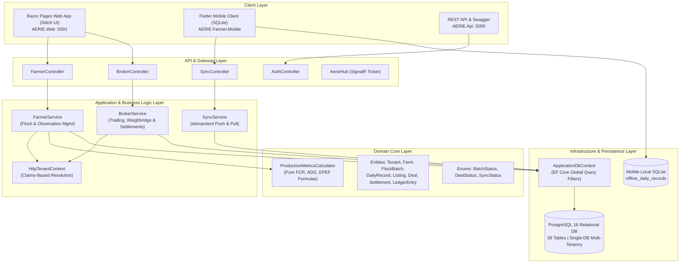

# AERIE — Intelligent Multi-Tenant SaaS ERP Ecosystem for Poultry Supply Chain

[](https://dotnet.microsoft.com/)
[](https://www.postgresql.org/)
[](https://flutter.dev/)
[]()
[]()

> **Final Year Project (FYP):** An Intelligent, Multi-Tenant SaaS ERP Ecosystem for End-to-End Poultry Supply Chain Optimization.  
> **Phase 1 Production Release:** Fully integrated **Farmer Module** and **Broker Module** running on a shared multi-tenant relational core, single unified authentication system, and real-time trading pipeline.

---

## 1. System Architecture Overview

AERIE is engineered following Clean Architecture and Domain-Driven Design (DDD) principles. It enforces strict separation of concerns, multi-tenant logical isolation at the persistence layer, and offline-first mobile operation.



---

## 2. Implemented Modules & Capabilities

### 2.1 Farmer Module — Farm & Flock Production Management
- **Farm & Poultry House Hierarchy:** Multi-farm management with climate-control specifications, capacity limits, and bird density tracking.
- **Flock Lifecycle & Breed Benchmarking:** Breed targets (Cobb 500, Ross 308, Hubbard), placement records, daily age tracking, and flock mortality indexing.
- **Daily Observation Capture:** Real-time logging of dead birds, feed consumed (kg), water intake (L), and sample body weights (g).
- **Automated Mathematical KPI Engine:**
  - **FCR (Feed Conversion Ratio):** $\text{FCR} = \frac{\text{Total Feed Consumed (kg)}}{\text{Total Weight Gained (kg)}}$
  - **ADG (Average Daily Gain):** $\text{ADG} = \frac{\text{Weight Gained (g)}}{\text{Age in Days}}$
  - **Mortality Rate (%):** $\text{Mortality \%} = \frac{\text{Cumulative Mortality}}{\text{Initial Placed Count}} \times 100$
  - **EPEF (European Production Efficiency Factor):** $\text{EPEF} = \frac{\text{Survival Rate \%} \times \text{Avg Body Weight (kg)}}{\text{Age (days)} \times \text{FCR}} \times 100$
- **Marketplace Publishing:** Automated transition to `ReadyForSale` and deliberate publishing of available broiler lots with price expectations.

### 2.2 Broker Module — Poultry Trading, Lifting & Financial Settlement
- **Cross-Tenant Marketplace Discovery:** Broiler batch discovery with city filtering, target weights, and flock age indicators.
- **Deal Proposals & Bidding:** Purchase bids specifying price per kg, vehicle registration number, and scheduled lifting dates.
- **Atomic Concurrency Reservation:** Automatic quantity decrementing during proposal acceptance, preventing overselling or concurrent double-booking.
- **Lifting & Weighbridge Integration:** Vehicle ticket entry recording Gross Weight, Tare Weight, Net Bird Weight, Loaded Count, and transport shrinkage.
- **Automated Settlement & Commission Engine:**
  - Gross flock value calculation based on net weighbridge kg.
  - Transparent deduction of broker commissions (per-kg or flat) and freight transport expenses.
  - Computation of net farmer payout.
- **Invoicing & Double-Entry Bookkeeping Ledger:**
  - Automated generation of buyer invoices and seller payment vouchers.
  - Balanced double-entry financial journal (`Debit Accounts Receivable`, `Credit Broiler Sales Revenue`, `Debit Freight Expense`, `Debit Broker Commission`).

### 2.3 Offline-First Mobile Synchronization Engine
- **Field-Resilient SQLite Storage:** Embedded SQLite database (`aerie_farmer_offline.db`) allows shed workers to log mortality and feed consumption completely offline.
- **Idempotent Synchronization Contract:** Client-generated UUID `ClientRecordId` guarantees that network timeouts and retries never duplicate production records or mortality counts.
- **Automated Network Reconnect Detection:** Background connectivity listener detects restored internet and triggers automatic synchronization within 5 seconds.
- **Server-Wins Reconciliation:** Conflict-free version management ensuring auditability across web and mobile touchpoints.

---

## 3. Solution Structure

```text
e:\FYP Proect\AERIE\
├── AERIE.sln                              # Master Visual Studio / .NET 9 Solution
├── schema.sql                             # Complete Idempotent PostgreSQL 16 DDL Script
├── AERIE_REQUIREMENTS_TRACEABILITY.md     # Proposal Requirements Traceability Matrix
├── SETUP_GUIDE.md                         # Local Setup & Verification Runbook
├── README.md                              # Main Architectural Documentation
│
├── src\
│   ├── AERIE.Domain\                      # Pure Domain Entities, Enums & Mathematical Calculators
│   ├── AERIE.Application\                 # DTOs, Service Interfaces, Core Business Logic & Workflows
│   ├── AERIE.Infrastructure\              # EF Core 9 Npgsql, Multi-Tenant Query Filters, Migrations
│   ├── AERIE.Api\                         # ASP.NET Core REST API, Swagger Bearer Auth & SignalR Hub
│   ├── AERIE.Web\                         # Razor Pages Web Application (Stitch UI Design System)
│   └── AERIE.Farmer.Mobile\               # Flutter Mobile Client with SQLite (sqflite) & Auto-Sync
│
└── tests\
    ├── AERIE.Tests.Unit\                  # Unit Test Suite for Domain Formulas & Calculations
    └── AERIE.Tests.Integration\           # Multi-Tenant Isolation, Overselling & Workflow Tests
```

---

## 4. Quick Start & Execution

### 1. Database Migration
```powershell
dotnet ef database update --project src/AERIE.Infrastructure --startup-project src/AERIE.Api
```

### 2. Launch Web API Gateway
```powershell
dotnet run --project src/AERIE.Api
```
- Swagger API Docs: `http://localhost:5000/swagger`
- SignalR Market Hub: `http://localhost:5000/hubs/aerie`

### 3. Launch Web Application Portal
```powershell
dotnet run --project src/AERIE.Web
```
- Web Application: `http://localhost:5001`

### 4. Run Automated Test Suite
```powershell
dotnet test AERIE.sln --logger "console;verbosity=normal"
```

For detailed step-by-step setup and grading instructions, refer to [SETUP_GUIDE.md](file:///e:/FYP%20Proect/AERIE/SETUP_GUIDE.md).  
For the complete compliance breakdown against the FYP proposal, refer to [AERIE_REQUIREMENTS_TRACEABILITY.md](file:///e:/FYP%20Proect/AERIE/AERIE_REQUIREMENTS_TRACEABILITY.md).
